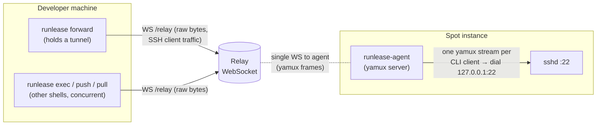

# Runlease — Project CLAUDE.md

Runlease provisions ephemeral cloud spot instances and routes terminal/port traffic to them through a credential-less WebSocket relay. Use case: a developer (or AI agent) needs a short-lived VM to run a build, deploy, test against — without opening inbound firewall rules and without persistent infra.

The relay never sees plaintext. Even if it's compromised it can't authenticate to the instance, impersonate it, or decrypt traffic.

---

## Repo Layout

```
cmd/runlease/         CLI (cobra subcommands; one file per command)
cmd/runlease-agent/   Tiny binary that runs on each launched instance — registers with relay, runs yamux server
cmd/runlease-relay/   Public WebSocket relay server (deployed to a fixed VM)
pkg/manifest/         Manifest YAML schema + validation + setup-file inlining
pkg/userdata/         Templated boot script — sshd hardening, agent install, optional sudo + setup steps
pkg/agent/            Agent core loop (importable; cmd/runlease-agent/main.go is a thin wrapper)
pkg/relay/            Relay HTTP+WS server, yamux session coordinator, wsConn net.Conn wrapper
pkg/credential/       Per-instance keypair gen + envelope-encrypted at-rest storage
pkg/registry/         ~/.runlease/registry.json — instance handles, relay tokens, manifest forwards
pkg/config/           ~/.runlease/config.yaml — user defaults
pkg/provider/         Cloud provider interface + aws/, gcp/, azure/ implementations
pkg/instanceclass/    compute.small → e2-standard-2 etc. catalog resolver
pkg/lifecycle/        Reclaim daemon (TTL expiry sweeper)
pkg/signin/           `runlease login`: Google device sign-in flow + saved session (~/.runlease/auth.json)
deploy/relay/         Terraform module for a relay VM (gcp/) + tiers.example.yaml
site/                 Project website, published by .github/workflows/pages.yml
docs/                 Reference + integration docs (Mermaid only — no ASCII diagrams)
                      - manifest.md            full schema reference (CLI: `runlease manifest schema`)
                      - private-ar-k3s.md      kubelet CredentialProvider pattern for private GCP AR pulls
                      - k3s-bastion-integration.md  proposed `k3s:` manifest convenience layer
examples/manifests/   Sample manifest YAMLs
```

Single Go module: `github.com/marshal-org/runlease` (Go 1.26+).

---

## Tech Stack

- Go 1.26, modules at repo root
- CLI: `spf13/cobra` v1.10
- WebSocket: `gorilla/websocket`
- Multiplexing: `hashicorp/yamux` (agent↔relay link; one yamux session per agent, one stream per CLI client)
- SSH client: `golang.org/x/crypto/ssh` (CLI side and bridged through forwards)
- SFTP: `pkg/sftp` (push/pull)
- Logging: `log/slog` to stderr (JSON or text depending on the binary)
- Cloud SDKs: AWS SDK v2, GCP compute via `google.golang.org/api`, Azure SDK
- Auth: Google ID token (relay-side allow-list); local KMS via per-user `master.key`

---

## Required Env Vars

**Relay (`cmd/runlease-relay`)**:
- `--addr :7777` and `--agent-binary <path>` are flags, not env vars.
- `--audience` plus `--allowed-emails` / `--allowed-domains` gate `register` handshakes. The relay refuses to start without auth unless `--insecure-no-auth` is passed.
- `--max-slots` caps live slots (default 5000).

**Agent (`cmd/runlease-agent`)**:
- `RUNLEASE_RELAY_ADDR` — `ws://host:port` or `wss://host` or bare `host:port`.
- `RUNLEASE_RELAY_TOKEN` — 32-byte hex, pre-registered by the CLI at `runlease up` time.
- `RUNLEASE_LOCAL_TARGET` (optional) — TCP dial target per yamux stream. Default `localhost:22`. Used in tests; could also bridge to non-standard sshd.

**CLI (`cmd/runlease`)**:
- `RUNLEASE_HOME` (optional) — base directory for `config.yaml`, `registry.json`, `master.key`, `credentials/`. Default `~/.runlease`.

---

## Build & Test

```bash
go build ./...                          # all three binaries
go build -o ./runlease ./cmd/runlease   # CLI only (host arch)
go test ./...                           # full test sweep (~10s)
go vet ./...                            # static analysis

# cross-compile relay+agent for the deployed Linux VM:
GOOS=linux GOARCH=amd64 CGO_ENABLED=0 go build -ldflags="-s -w" -o /tmp/runlease-relay-linux ./cmd/runlease-relay
GOOS=linux GOARCH=amd64 CGO_ENABLED=0 go build -ldflags="-s -w" -o /tmp/runlease-agent-linux ./cmd/runlease-agent
```

Tests are pure Go — no docker, no env setup. `pkg/relay/server_test.go` brings up the real HTTP+WS server in-process and exercises the full yamux path (incl. `TestRelay_concurrentClients` proving multi-stream).

---

## Architecture

### Yamux relay-mux (since 0.0.6)



- The agent runs `yamux.Server` on its outbound WebSocket.
- The relay runs `yamux.Client` against the agent and calls `OpenStream()` for every incoming CLI client. The CLI side stays a raw byte stream — yamux is terminated by the relay against the agent's socket.
- Any number of concurrent CLI processes work against one VM through one agent socket. `forward` holding a tunnel + another shell running `exec`/`push`/`pull` is the canonical demo.
- yamux keepalives **stay enabled** — gorilla WebSocket doesn't ping on its own, so NAT timeouts would otherwise drop idle agent sessions.

### Token/slot lifecycle

1. `runlease up` registers a random 32-byte token with the relay (`role: register`, gated by Google ID token allow-list).
2. The new VM boots; its startup script runs `runlease-agent` with that token in env.
3. The agent connects to the relay with `role: instance, token: …` and gets `status: registered`.
4. The relay wraps the agent WS in `yamux.Client` and the slot is ready (`/ready` returns 200).
5. Each CLI subcommand opens a fresh WebSocket with `role: client, token: …` — relay does `session.OpenStream()` and bridges the stream to the CLI WebSocket.
6. A slot lives for its tier's `slotTTL` (24h when no tiers file sets one) and is dropped earlier after `idleTTL` with no agent or client. Past that, reconnects are rejected until the CLI registers the token again (`runlease connect` does). `down`, `sync`, the daemon and a failed `up` release the slot at once.

### Instance lifecycle

The registry is the only local record of a machine, so these rules keep it from losing one:

1. `up` refuses a name that is in the registry and whose machine still exists (`freeName`). If the machine is gone, the stale entry is cleared first.
2. The entry is written (`State: pending`) as soon as the create request is accepted, before the wait for running. A create error that comes with a handle still gets recorded. A machine that cannot be recorded is deleted (`abandonLaunch`).
3. Every registry write goes through `Registry.mutate`: file lock, re-read, one change, atomic rename. Never write back a map loaded earlier. Remove by instance ID (`RemoveID`), not by name.
4. Gone means the cloud says not found (or AWS `terminated`). Powered off (`StatusStopped`, including GCP `TERMINATED`) still exists and is billed: `sync` and the daemon delete it before dropping the entry.
5. The lease is a deadline on the VM's disk (`/var/lib/runlease/lease-deadline`), re-armed at each boot by `runlease-lease.service`. The boot script runs once (`/var/lib/runlease/booted`). `selfTermination` defaults to true.
6. The daemon rescans the registry every poll, retries a failed terminate, and reads the registry again before acting on a deadline.

### What lives where

- **Manifest schema** — `pkg/manifest/manifest.go`. New fields go here. The wizard (`cmd/runlease/manifest.go`) emits commented hints — keep it in sync when adding fields.
- **Userdata template** — `pkg/userdata/userdata.go`. The template is a Go raw string literal, so **no backticks** inside it (use single-quotes).
- **CLI subcommands** — one file per command in `cmd/runlease/`. Convention: `var fooCmd = &cobra.Command{…}; func runFoo(cmd, args)`. `runlease forward` and friends share `newSSHClient` from `forward.go`.
- **Registry** — `~/.runlease/registry.json` (or `$RUNLEASE_HOME/registry.json`). One entry per launched instance; includes `Forwards` snapshot for `forward --all`.

---

## Security Invariants

These must hold regardless of feature work:

1. **The relay holds nothing that can open a session.** It never sees SSH keys or plaintext bytes from the SSH session. It does see two things: the Google ID token a CLI presents to register a slot or call `/me`, which it verifies and does not store, and the OAuth client ID and secret of the sign-in client, which it publishes to CLIs (an installed-application client; Google does not treat that secret as confidential). Don't give the relay any secret that grants access to a VM or a cloud account. Even on the agent side, the relay holds yamux frames — the SSH protocol on top is end-to-end between CLI and sshd. Don't add anything that requires the relay to inspect application bytes.
2. **Host keys are pre-issued, not TOFU.** `runlease up` generates the instance's ed25519 host keypair locally; the public key is embedded in the userdata for sshd and the private key is base64'd into the userdata. The CLI side uses `cryptossh.FixedHostKey` against the known public key. Don't introduce `InsecureIgnoreHostKey` or trust-on-first-use anywhere.
3. **sshd is hardened by the bootstrap.** `PasswordAuthentication no`, `AllowUsers runlease-agent`, `PermitRootLogin no`, only ed25519 host key offered. Don't relax this without explicit user request.
4. **Sudo is locked by default.** Only `/usr/local/bin/runlease-terminate` and `/usr/local/bin/runlease-snooze` are NOPASSWD (the latter re-arms the named `runlease-selfterminate` timer for `runlease snooze`). `manifest.sudo: passwordless` is the opt-in. Don't add fields that quietly grant elevated privileges, and gate any new NOPASSWD entry to a single specific script.
5. **The agent is verified and unprivileged.** The boot script checks the relay-served agent against a SHA-256 before running it, and the agent's systemd unit runs as `runlease-agent` with no capabilities. Don't add a path that executes an unverified download or runs the agent as root.
6. **The relay fails closed.** It validates slot tokens (32 to 128 chars of `[A-Za-z0-9_-]`), caps slots, and won't start open by accident. Never slice or log a token without going through `shortTok`.
7. **Connection ownership.** `newSSHClient` and `execOverConn` close `conn` on every error path; callers don't double-close. SFTP/forward clients are bound to one SSH client they own end-to-end.

---

## Go Conventions

- **Errors** wrap with context: `fmt.Errorf("operation: %w", err)`.
- **Logging** is `log/slog` to stderr. Use structured key/value pairs, never `fmt.Sprintf` into a single string.
- **Cobra commands**: each subcommand has its own `init()` that calls `rootCmd.AddCommand`. Flags are package-level vars (`var manifestPath string`). Don't introduce a global flag-config struct.
- **Cobra args**: prefer `cobra.MinimumNArgs(N)` / `RangeArgs`. For "first arg might be instance name, might not", use `resolveInstance(cmd, reg, args, verb)` in `cmd/runlease/root.go`.
- **Provider abstraction**: anything cloud-specific lives behind `pkg/provider/interface.go`. Don't `import "github.com/aws/…"` outside `pkg/provider/aws/`.
- **Tests**: pure Go, no fixtures dir. Use `t.TempDir()` and `httptest.NewServer`. The `fakeAgent` helper in `pkg/relay/server_test.go` is the canonical way to test relay flows.

---

## Deployment Story

The relay serves the agent binary at `/agent`, and every new VM downloads it at boot, so **relay version == agent version** by construction. Release builds of the CLI carry the SHA-256 of the matching agent and VMs refuse anything else, so a relay must run the **release** binaries (or manifests must pin `relay.agentSha256`).

How to deploy, authenticate and upgrade a relay: [`docs/self-hosting-relay.md`](docs/self-hosting-relay.md).

Existing VMs that booted with the previous agent are not auto-upgraded. They keep running their old agent until the spot instance dies.

---

## Commit & PR Conventions

- **Conventional commits**: `type(scope): subject`. Types: `feat`, `fix`, `docs`, `refactor`, `chore`, `test`. Scopes are component-local: `exec`, `forward`, `relay`, `agent`, `manifest`, `userdata`, `discover`, `attach`, `transfer`, `json`, `sudo`, `setup`, `forwards`. One commit per logical change, not one big mega-commit.
- **No `Co-Authored-By: Claude` or any "Generated by Claude" bylines** in commit messages or PR bodies. Ever.
- **Releases are managed by release-please** ([`googleapis/release-please-action@v4`](.github/workflows/release-please.yml)). runlease is a single Go module → one release-please package at the repo root (`.release-please-config.json` / `.release-please-manifest.json`), so it produces bare `vX.Y.Z` tags (no component prefix) and the three binaries (`runlease`, `runlease-agent`, `runlease-relay`) are released together. Flow: every push to `main` updates a "release PR" from conventional-commit history (`feat` → minor, `fix` → patch; `chore`/`docs`/`refactor`/`ci`/`test` don't bump). **Merging that release PR** bumps the version, regenerates the `CHANGELOG.md` entry, and creates the tag + GitHub Release; the same workflow's gated build job then attaches binaries for darwin/linux × amd64/arm64 + windows/amd64. So **don't hand-edit `CHANGELOG.md` or push `v*` tags manually** — let release-please do both. Conventional commit *types* now drive the version bump, so type them accurately.
- **PR test plan**: include a `## Test plan` checklist when the change spans more than a refactor. For yamux/protocol changes, include an explicit "deployed relay + spun up fresh VM + ran N concurrent clients" item; the unit tests aren't sufficient on their own.

---

## Common Pitfalls

- **Backticks in `pkg/userdata/userdata.go`**: the template is a Go raw string literal, so any backtick inside it is a Go syntax error. Use single-quotes in inline comments.
- **`runlease ssh` requires a TTY**: that's intentional. For non-interactive use, `runlease exec`.
- **Concurrent CLI calls work only against the deployed yamux relay.** If the relay binary on `runlease-relay` is older than `0.0.6`, a second CLI process gets `i/o timeout` on the relay handshake while the first is active. Verify the deployed version before assuming a relay bug.
