<p align="center"></p>

<h1 align="center">runlease</h1>

<p align="center">
  <strong>Spot machines for coding agents. Cheap, safe, and in your own cloud.</strong><br>
  Your keys never leave your machine, the relay cannot read your traffic, and every machine deletes itself.
</p>

<p align="center">
  <a href="https://github.com/marshal-org/runlease/actions/workflows/ci.yml"></a>
  <a href="https://github.com/marshal-org/runlease/releases"></a>
  <a href="LICENSE"></a>
  <a href="https://pkg.go.dev/github.com/marshal-org/runlease"></a>
</p>

<p align="center">
  Built by <a href="https://marshal.codes"><strong>Marshal</strong></a>: AI coding agents at full speed, with full receipts.<br>
  Marshal runs coding agents in isolated pods inside your own VPC. Runlease is the tool we built to give them, and our tests, a real machine for an hour.
</p>

<p align="center">
  
</p>

```bash
runlease up --provider gcp --size compute.large --ttl 2h   # a spot VM in your account
runlease exec <name> -- make test                          # run something on it
runlease down <name> --yes                                 # or let the lease delete it
```

One command gives an agent, a CI job or you a real Linux machine. It runs in **your** cloud
account at spot prices, has **no public address**, and **deletes itself** when its lease runs out.

---

## Why

Coding agents need somewhere to run things: build the project, start the stack, run the tests,
break something and try again. A laptop is the wrong place and a long-lived dev box is worse.

| | |
|---|---|
| **Yours** | The VM runs in your own GCP or AWS account, on your network, under your IAM. Nothing is hosted for you and nothing leaves your account. |
| **Cheap** | Spot capacity. `runlease up` shows the hourly price and the projected cost of the lease before it launches. |
| **Closed** | By default the VM has no public address and its SSH server listens on localhost only. The VM dials out to a relay; you reach it through that tunnel. |
| **Private** | The relay carries SSH. It holds no keys and cannot read, alter or impersonate a session. [How that works](docs/security.md). |
| **Managed** | Every machine has a lease. It deletes itself at the end of it, whether or not your laptop is still online. |
| **Scriptable** | `--output json` on every command, non-interactive `exec`, `push`, `pull` and `forward`. Built to be driven by an agent. |

## Install

```bash
curl -fsSL https://runlease.online/install.sh | sh
```

The [script](site/install.sh) downloads the release for your machine, checks its SHA-256 against
`checksums.txt`, and puts `runlease` in `~/.local/bin`. It uses no sudo. To do the same by hand:

```bash
VERSION=v0.5.0   # pick the latest
OS=linux ARCH=amd64   # or darwin / arm64
curl -fsSLO "https://github.com/marshal-org/runlease/releases/download/${VERSION}/runlease-${OS}-${ARCH}"
curl -fsSLO "https://github.com/marshal-org/runlease/releases/download/${VERSION}/checksums.txt"
sha256sum --check --ignore-missing checksums.txt
install -m 0755 "runlease-${OS}-${ARCH}" ~/.local/bin/runlease
```

Releases are signed. See [verifying a release](docs/security.md#verifying-a-release).

Or build from source (Go 1.26 or newer):

```bash
go install github.com/marshal-org/runlease/cmd/runlease@latest
```

A source build does not carry the agent checksum that release builds do. Read
[agent verification](docs/security.md#the-agent-binary-is-verified-before-it-runs) before using
one against a relay you do not run yourself.

## Quick start

You need credentials for one cloud: `gcloud auth application-default login` (and
`gcloud config set project MY_PROJECT`) for GCP, or the usual AWS credential chain.

```bash
runlease login                          # the free public relay: approve a short code in a browser
runlease doctor                         # optional: checks sign-ins, project and network, prints the fix
runlease up -p gcp -n box -d            # or -p aws: a small spot machine, gone in two hours
                                        # no NAT gateway on the subnet? it stops and says so: add --public-ip
runlease exec box -- uname -a           # run something
runlease connect box                    # or open a shell
runlease forward box -L 8080:localhost:8080   # reach a port on the VM
runlease push box ./build.tar /tmp/build.tar
runlease snooze box 1h                  # extend the lease
runlease down box --yes                 # delete it now
```

Run `runlease configure` once to save a default cloud, region and size; after that a bare
`runlease up` is enough.

For anything repeatable, describe the machine in a manifest:

```yaml
# agent-box.yaml
name: agent-box
provider: gcp
region: us-central1-a
instanceClass: compute.large
reclaim:
  ttl: 3h
  selfTermination: true
relay:
  addr: wss://relay.example.com
setup:
  - name: toolchain
    run: |
      apt-get update && apt-get install -y build-essential git
forwards:
  - local: 3000
    remote: 3000
```

```bash
runlease up -m agent-box.yaml --attach
```

`runlease manifest new` writes one interactively. Every field is in the
[manifest reference](docs/manifest.md).

### Finding machines this computer has forgotten

`runlease list` shows what this computer launched and still remembers. It also asks your cloud
for every machine carrying the `runlease-managed` label, and lists the ones it does not track:
launched from another computer, or left behind stopped with a disk that still bills.

```bash
runlease list             # tracked machines, then anything found in the cloud
runlease down --leaked    # delete the stopped ones whose lease is over
runlease list --local     # skip the cloud lookup
runlease down --leaked --provider aws --region eu-north-1   # say where to look: an AWS region
runlease down --leaked --provider gcp --project my-project  # or a Google Cloud project, all zones
```

`down --leaked` never deletes a running machine. It only removes machines that are stopped and
past their lease.

Both look where this computer has launched before and in its saved default. With neither,
`down --leaked` and `list --untracked` look in each cloud signed in on this computer, in its
default place. `down --leaked` always prints where it is looking first, by name: the project ID,
or the region and account.

It deletes without asking (`--yes`, or `--output json`) only in a place that was named: by the
flags above, by a machine this computer tracks, or by the saved default. In a place it had to
fill in, it lists what it found, deletes nothing, and prints the command that names the place.

### When something is not working

```bash
runlease doctor                                       # every cloud signed in on this computer
runlease doctor --provider aws --region eu-north-1    # one cloud, one region
runlease doctor --output json                         # {"ok": bool, "checks": [{id, title, status, detail, fix}]}
```

`runlease doctor` creates nothing. It checks this CLI, the relay (set, reachable, signed in,
serving the agent this CLI expects) and each cloud (credentials, project or account, region,
network, NAT gateway), runs every check whatever the one before it found, and prints the
command that fixes each problem. It exits 1 if a check failed; a warning, such as a subnet
with no NAT gateway, does not fail it.

## How it works


1. `runlease up` generates two key pairs on your machine: one to log in with, and the VM's SSH
   **host key**. It also picks a random 256-bit slot token and registers it with the relay.
2. The VM boots. Its agent dials **out** to the relay and claims the slot.
3. Every command you run opens an SSH session through the relay to the VM's `sshd`. The CLI
   accepts only the host key it generated in step 1, so the relay cannot stand in for the VM.
4. A timer inside the VM deletes the instance when the lease ends.

The full walk-through, with the protocol and the boot sequence, is in
[docs/how-it-works.md](docs/how-it-works.md).

## Security

Runlease is built so that the one shared, internet-facing piece, the relay, is not something you
have to trust with your sessions.

- The relay never holds an SSH key, a cloud credential or plaintext.
- Host keys are issued before boot. Nothing is trusted on first use.
- The agent binary is checked against a SHA-256 compiled into the CLI before it runs.
- The agent runs unprivileged in a locked-down systemd unit. `sudo` on the VM is off unless the manifest turns it on.
- On AWS, instances require IMDSv2.

The [threat model](docs/security.md) says exactly what each party can and cannot do, and lists
the limits we know about. To report a vulnerability, see [SECURITY.md](SECURITY.md).

## The relay

A relay is one small Go binary. You have three choices:

- **Use the public one.** Free, with a Google sign-in and a limit of two machines at once:

  ```bash
  runlease login          # with no relay set, this picks the public one and saves it
  ```

  What it allows and what it sees: [the public relay](docs/relay-service.md).
- **Run your own.** It takes one VM or container and a TLS endpoint. See
  [self-hosting the relay](docs/self-hosting-relay.md). This is what we recommend for real work.
- **No relay at all.** Leave `relay.addr` empty and Runlease gives the VM a public IP and connects
  directly, or use `runlease iap` (GCP) or `runlease ssm` (AWS).

## Clouds

| Cloud | Status |
|---|---|
| Google Cloud | Supported |
| AWS | Supported |
| Azure, others | Not implemented. The [provider interface](pkg/provider/interface.go) is four methods, and a new provider is a good first contribution. |

Machine sizes are portable: `compute.small` to `compute.2xlarge` and `compute.gpu` map to a
concrete type per cloud. Run `runlease catalog` to see the mapping.

## Documentation

| | |
|---|---|
| [How it works](docs/how-it-works.md) | Architecture, protocol, boot sequence, lease lifecycle |
| [Security and threat model](docs/security.md) | What each party can do, known limits, release verification |
| [Manifest reference](docs/manifest.md) | Every field |
| [The public relay](docs/relay-service.md) | Sign in, free tier limits, what it logs |
| [Self-hosting the relay](docs/self-hosting-relay.md) | Deploy, authenticate, set tiers, operate |
| [CI and release pipeline](docs/ci.md) | How changes are tested and how releases are built and signed |

## Contributing

Issues and pull requests are welcome. Start with [CONTRIBUTING.md](CONTRIBUTING.md). Changes to
the relay, the boot script or credential handling get an extra-careful review; the pull request
template says what we look for.

This project follows the [Contributor Covenant](CODE_OF_CONDUCT.md).

## Status

Pre-1.0. The CLI and the manifest format can still change between minor versions; the
[changelog](CHANGELOG.md) calls out every breaking change.

## License

[Apache License 2.0](LICENSE).

## Built by Marshal

Runlease is built and maintained by [Marshal](https://marshal.codes). Marshal runs AI coding
agents in isolated pods inside your own VPC, with credential isolation, audited egress and live
tool policies.

Runlease stands alone: you do not need Marshal to use it. We built it to give agents and tests a
real machine for an hour, and we use it ourselves.
