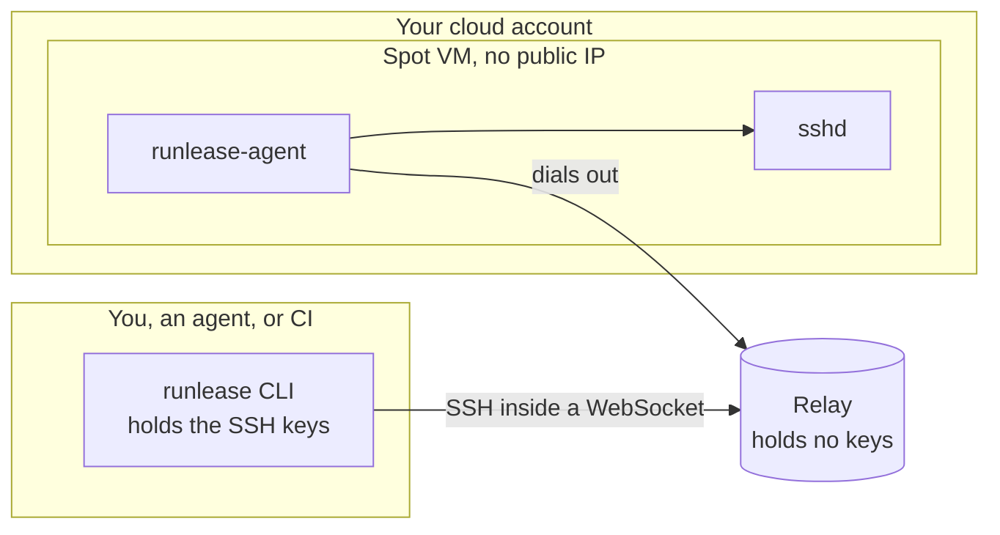

<h1 align="center">runlease</h1>

<p align="center">
  <strong>Disposable cloud machines for coding agents.</strong><br>
  Secure, cheap spot VMs in your own cloud account, with the whole lifecycle managed for you.
</p>

<p align="center">
  <a href="https://github.com/marshal-org/runlease/actions/workflows/ci.yml"></a>
  <a href="https://github.com/marshal-org/runlease/releases"></a>
  <a href="LICENSE"></a>
  <a href="https://pkg.go.dev/github.com/marshal-org/runlease"></a>
</p>

```bash
runlease up --provider gcp --size compute.large --ttl 2h   # a spot VM, no public IP
runlease exec <name> -- make test                          # run something on it
runlease down <name> --yes                                 # or let the lease delete it
```

One command gives an agent, a CI job or you a real Linux machine. It runs in **your** cloud
account at spot prices, has **no inbound ports**, and **deletes itself** when its lease runs out.

---

## Why

Coding agents need somewhere to run things: build the project, start the stack, run the tests,
break something and try again. A laptop is the wrong place and a long-lived dev box is worse.

| | |
|---|---|
| **Yours** | The VM runs in your own GCP or AWS account, on your network, under your IAM. Nothing is hosted for you and nothing leaves your account. |
| **Cheap** | Spot capacity. `runlease up` shows the hourly price and the projected cost of the lease before it launches. |
| **Closed** | No public IP and no inbound firewall rule. The VM dials out to a relay; you reach it through that tunnel. |
| **Private** | The relay carries SSH. It holds no keys and cannot read, alter or impersonate a session. [How that works](docs/security.md). |
| **Managed** | Every machine has a lease. It deletes itself at the end of it, whether or not your laptop is still online. |
| **Scriptable** | `--output json` on every command, non-interactive `exec`, `push`, `pull` and `forward`. Built to be driven by an agent. |

## Install

Download a binary from the [releases page](https://github.com/marshal-org/runlease/releases)
and check it against `checksums.txt`:

```bash
VERSION=v0.5.0   # pick the latest
OS=linux ARCH=amd64   # or darwin / arm64
curl -fsSLO "https://github.com/marshal-org/runlease/releases/download/${VERSION}/runlease-${OS}-${ARCH}"
curl -fsSLO "https://github.com/marshal-org/runlease/releases/download/${VERSION}/checksums.txt"
sha256sum --check --ignore-missing checksums.txt
install -m 0755 "runlease-${OS}-${ARCH}" /usr/local/bin/runlease
```

Releases are signed. See [verifying a release](docs/security.md#verifying-a-release).

Or build from source (Go 1.26 or newer):

```bash
go install github.com/marshal-org/runlease/cmd/runlease@latest
```

A source build does not carry the agent checksum that release builds do. Read
[agent verification](docs/security.md#the-agent-binary-is-verified-before-it-runs) before using
one against a relay you do not run yourself.

## Quick start

You need credentials for one cloud: `gcloud auth application-default login` for GCP, or the usual
AWS credential chain.

```bash
runlease configure                      # provider, region, relay, default size and lease
runlease up                             # launch with your defaults
runlease exec <name> -- make test       # run something
runlease forward <name> -L 8080:localhost:8080   # reach a port on the VM
runlease push <name> ./build.tar /tmp/build.tar
runlease snooze <name> 1h               # extend the lease
runlease down <name>                    # delete it now
```

For anything repeatable, describe the machine in a manifest:

```yaml
# agent-box.yaml
name: agent-box
provider: gcp
region: us-central1-a
instanceClass: compute.large
reclaim:
  ttl: 3h
  selfTermination: true
relay:
  addr: wss://relay.example.com
setup:
  - name: toolchain
    run: |
      apt-get update && apt-get install -y build-essential git
forwards:
  - local: 3000
    remote: 3000
```

```bash
runlease up -m agent-box.yaml --attach
```

`runlease manifest new` writes one interactively. Every field is in the
[manifest reference](docs/manifest.md).

## How it works



1. `runlease up` generates two key pairs on your machine: one to log in with, and the VM's SSH
   **host key**. It also picks a random 256-bit slot token and registers it with the relay.
2. The VM boots with no public address. Its agent dials **out** to the relay and claims the slot.
3. Every command you run opens an SSH session through the relay to the VM's `sshd`. The CLI
   accepts only the host key it generated in step 1, so the relay cannot stand in for the VM.
4. A timer inside the VM deletes the instance when the lease ends.

The full walk-through, with the protocol and the boot sequence, is in
[docs/how-it-works.md](docs/how-it-works.md).

## Security

Runlease is built so that the one shared, internet-facing piece, the relay, is not something you
have to trust with your sessions.

- The relay never holds an SSH key, a cloud credential or plaintext.
- Host keys are issued before boot. Nothing is trusted on first use.
- The agent binary is checked against a SHA-256 compiled into the CLI before it runs.
- The agent runs unprivileged in a locked-down systemd unit. `sudo` on the VM is off unless the manifest turns it on.
- On AWS, instances require IMDSv2.

The [threat model](docs/security.md) says exactly what each party can and cannot do, and lists
the limits we know about. To report a vulnerability, see [SECURITY.md](SECURITY.md).

## The relay

A relay is one small Go binary. You have two choices:

- **Run your own.** It takes one VM or container and a TLS endpoint. See
  [self-hosting the relay](docs/self-hosting-relay.md). This is what we recommend for real work.
- **No relay at all.** Leave `relay.addr` empty and Runlease gives the VM a public IP and connects
  directly, or use `runlease iap` (GCP) or `runlease ssm` (AWS).

## Clouds

| Cloud | Status |
|---|---|
| Google Cloud | Supported |
| AWS | Supported |
| Azure, others | Not implemented. The [provider interface](pkg/provider/interface.go) is four methods, and a new provider is a good first contribution. |

Machine sizes are portable: `compute.small` to `compute.2xlarge` and `compute.gpu` map to a
concrete type per cloud. Run `runlease catalog` to see the mapping.

## Documentation

| | |
|---|---|
| [How it works](docs/how-it-works.md) | Architecture, protocol, boot sequence, lease lifecycle |
| [Security and threat model](docs/security.md) | What each party can do, known limits, release verification |
| [Manifest reference](docs/manifest.md) | Every field |
| [Self-hosting the relay](docs/self-hosting-relay.md) | Deploy, authenticate, operate |
| [CI and release pipeline](docs/ci.md) | How changes are tested and how releases are built and signed |
| [Private registry pulls on k3s](docs/private-ar-k3s.md) | A worked recipe |

## Contributing

Issues and pull requests are welcome. Start with [CONTRIBUTING.md](CONTRIBUTING.md). Changes to
the relay, the boot script or credential handling get an extra-careful review; the pull request
template says what we look for.

This project follows the [Contributor Covenant](CODE_OF_CONDUCT.md).

## Status

Pre-1.0. The CLI and the manifest format can still change between minor versions; the
[changelog](CHANGELOG.md) calls out every breaking change.

## License

[Apache License 2.0](LICENSE).

Runlease is built and maintained by the team behind [Marshal](https://marshal.codes), the
platform for running AI agent work with policy, credentials and audit built in.
