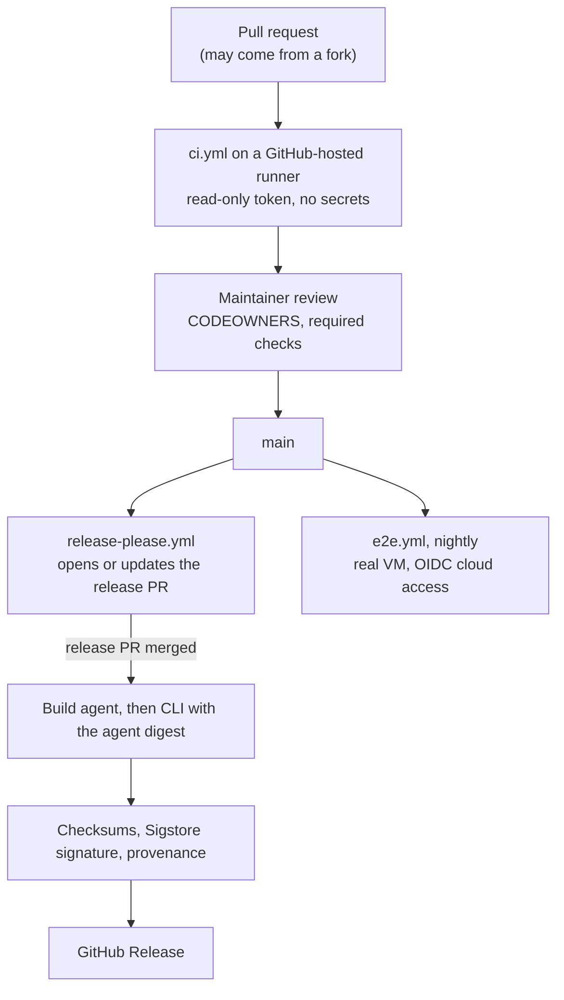

# CI and release pipeline

An open source project runs code written by strangers. This page says how Runlease does that
without handing those strangers its infrastructure, its cloud account or its release keys.

---

## The rule

**Untrusted code never meets a secret, and never runs on a machine we own.**

Everything below follows from it.

## Two kinds of workflow

| | Untrusted lane | Trusted lane |
|---|---|---|
| Workflows | `ci.yml`, `codeql.yml` | `release-please.yml`, `e2e.yml`, `scorecard.yml`, `pages.yml` |
| Triggered by | Any pull request, including from a fork | A push to `main`, a schedule, or a maintainer by hand |
| Code it runs | Whatever the pull request contains | Code a maintainer has reviewed and merged |
| Token | Read-only | Write, only where a job needs it |
| Secrets and cloud access | None | Short-lived, through OIDC |
| Runner | GitHub-hosted | GitHub-hosted |

## What runs on a pull request

`ci.yml`, on every pull request and every push to `main`:

| Job | Checks |
|---|---|
| Build and test | `gofmt`, `go mod tidy` is clean, `go build`, `go vet`, `go test`, and a cross-compile for macOS and Windows |
| Static analysis | `staticcheck` |
| Workflow policy | `scripts/check-workflows.sh`: hosted runners only, no secrets, pinned actions, safe triggers |
| Known vulnerabilities | `govulncheck`, which fails only on vulnerabilities the code can actually reach |
| Secret scan | `gitleaks` over the full history |
| Dependency review | Fails a pull request that adds a dependency with a known vulnerability |

`codeql.yml` adds code scanning with the security-extended query set.

All of them are required before merge.

## Why fork pull requests are safe

- **`pull_request`, never `pull_request_target`.** A fork's workflow run gets a read-only token and
  no secrets. `pull_request_target` would run with the base repository's secrets, and is the cause
  of most CI compromises in open source. It is not used anywhere in this repository.
- **GitHub-hosted runners.** Every job runs on `ubuntu-latest`: a fresh virtual machine that is
  destroyed after the job. A self-hosted runner that executes fork code is a foothold on your
  network that survives the job, so none is used.
- **First-time contributors need approval.** A maintainer clicks "approve and run" before a new
  contributor's workflow starts.
- **Actions are pinned to a commit SHA.** A tag can be moved to point at new code; a SHA cannot.
  Dependabot proposes the updates.
- **Least privilege.** Every workflow starts from `permissions: contents: read` and each job adds
  only what it needs.
- **`persist-credentials: false`** on every checkout, so the token is not left in the working tree
  for later steps.

## End-to-end tests

Unit tests cannot prove that a VM boots, registers, accepts a session and then really goes away.
`e2e.yml` does, against a real cloud account:

1. Build the CLI from the commit under test.
2. `runlease up` a small spot VM with a short lease.
3. `exec`, `push`, `pull` and `forward` through the relay.
4. `runlease down`, then ask the cloud API directly whether the instance still exists.
5. Fail if anything tagged `runlease-managed` by this run is left behind.

This workflow holds cloud access, so it is the most carefully fenced one:

- It **never runs on a pull request**. It runs nightly on `main`, or when a maintainer starts it
  by hand for a specific commit they have read.
- It authenticates with **OIDC workload identity federation**. There is no cloud key in the
  repository's secrets to steal.
- The cloud identity it assumes can create and delete instances in one dedicated, empty project
  with a budget cap, and nothing else.
- It runs in a GitHub **environment** (`e2e`) that can require a reviewer.
- It is off until the repository variable `E2E_ENABLED` is `true`.

To test a contributor's change end to end, a maintainer reads the diff, then runs the workflow by
hand with that commit's SHA.

## Releases

Releases are cut by [release-please](https://github.com/googleapis/release-please) from
conventional commits: `feat` bumps the minor version, `fix` the patch. Merging the release pull
request creates the tag and the GitHub Release, and the same run builds and uploads the binaries.

The build order matters:

1. **Agent and relay** are built first, for linux/amd64 and linux/arm64.
2. The SHA-256 of the linux/amd64 agent is computed.
3. **The CLI** is built for every platform with that digest compiled in. A VM launched by that CLI
   refuses any agent that does not match.
4. `checksums.txt` is generated over every file.
5. `checksums.txt` is **signed with Sigstore**, keyless, using the workflow's own OIDC identity.
   There is no signing key to leak.
6. A **build provenance attestation** is produced for every binary.

Steps 5 and 6 write the repository's identity to a public transparency log, so they are skipped
while the repository is private.

How to check a download: [verifying a release](security.md#verifying-a-release).

## The website

`pages.yml` publishes the `site/` directory to GitHub Pages when a change to it reaches `main`.

- It needs no secret. Pages deployment uses the workflow's own OIDC identity.
- It skips itself until Pages is switched on for the repository, so merging the workflow
  publishes nothing by accident.
- `scripts/check-site.sh` runs first, and on every pull request: every page is complete, every
  local link resolves, and no page loads a script from another site. Every page a search engine
  may index has a description and a canonical address, and the sitemap lists exactly those
  pages.
- The published `sitemap.xml` is written at deploy time by `scripts/gen-sitemap.sh`, which dates
  each page by the last commit that changed it. A new page needs a line in `site/sitemap.xml`
  too: run `scripts/gen-sitemap.sh > site/sitemap.xml`.

Switching it on is a repository setting: *Settings, Pages, Source: GitHub Actions*, then the
custom domain. With the domain's DNS at another provider, the apex needs A records for GitHub
Pages' four addresses and `www` needs a CNAME to `marshal-org.github.io`.

## Supply chain upkeep

- **Dependabot** opens grouped weekly updates for Go modules and for GitHub Actions.
- **OpenSSF Scorecard** scores the repository weekly and publishes the result.
- **Private vulnerability reporting** is on. See [SECURITY.md](../SECURITY.md).

## Repository settings this depends on

Workflow files are half of it. These settings are the other half, and a maintainer has to set them
in the GitHub UI:

| Setting | Value |
|---|---|
| Branch protection on `main` | Pull request required, 1 approval, code owner review, required checks, no force push, no bypass for admins |
| Actions: fork pull request workflows | Require approval for first-time contributors |
| Actions: default workflow permissions | Read-only |
| Actions: allow actions to approve pull requests | Off |
| Private vulnerability reporting | On |
| Secret scanning and push protection | On |
| Dependency graph, Dependabot alerts | On |
| Environment `e2e` | Required reviewer, restricted to `main` |
| Environment `github-pages` | Restricted to `main` |
| Pages | Source: GitHub Actions; custom domain; enforce HTTPS |
| Actions: require actions to be pinned to a full-length commit SHA | On |

## Isolation from the rest of the organisation

The repository lives in a GitHub organisation that also holds private projects. Its pipelines are
built so that nothing belonging to those projects is reachable from here, by a contributor or by
a compromised workflow.

**In this repository**

- Every job runs on a GitHub-hosted runner. No job can select a self-hosted runner, directly or
  through a variable.
- No workflow references a secret other than the built-in `GITHUB_TOKEN`, and no variable other
  than the end-to-end test's own `E2E_*`, which are set on this repository's `e2e` environment.
- `scripts/check-workflows.sh` enforces this, plus action pinning, the trigger rules and the
  permissions block, on every pull request. A change that breaks the isolation fails CI.

**In the organisation** (settings, not files)

| Asset | Setting that keeps it out of reach |
|---|---|
| Organisation secrets and variables | Visibility "selected repositories", and this repository is not selected |
| Self-hosted runner groups | Limited to selected repositories, with "allow public repositories" off |
| Cloud workload identity | The provider's condition names the repositories allowed to use it. This one is not among them |
| The end-to-end test's cloud project | A separate project with nothing else in it, trusting only `repo:marshal-org/runlease:environment:e2e` |
| GitHub Apps | Installed on selected repositories. Only apps that this project needs are installed here |

## While the repository is private

GitHub-hosted minutes for a private repository come out of the organisation's plan; for a public
one they are free. Code scanning and the dependency graph are free only for public repositories,
and Sigstore signing and attestation write the repository's identity to a public log. So CodeQL,
dependency review, Scorecard, signing and attestation each carry an `if:` on the repository's
visibility: they skip while it is private and switch on by themselves the day it goes public.
