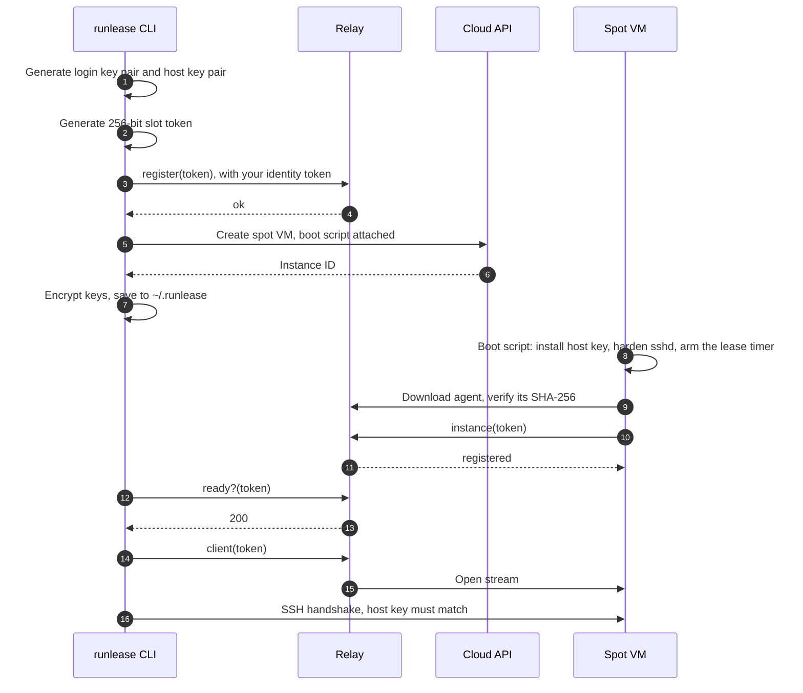
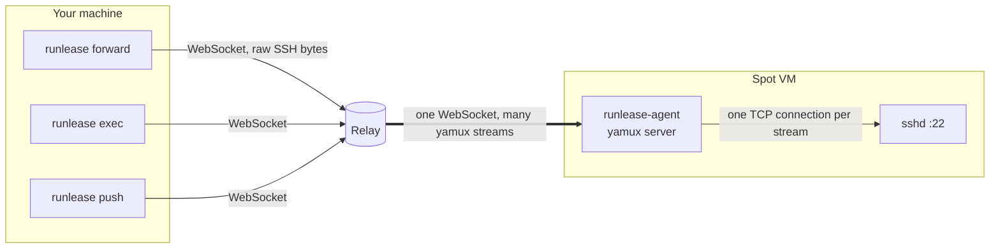
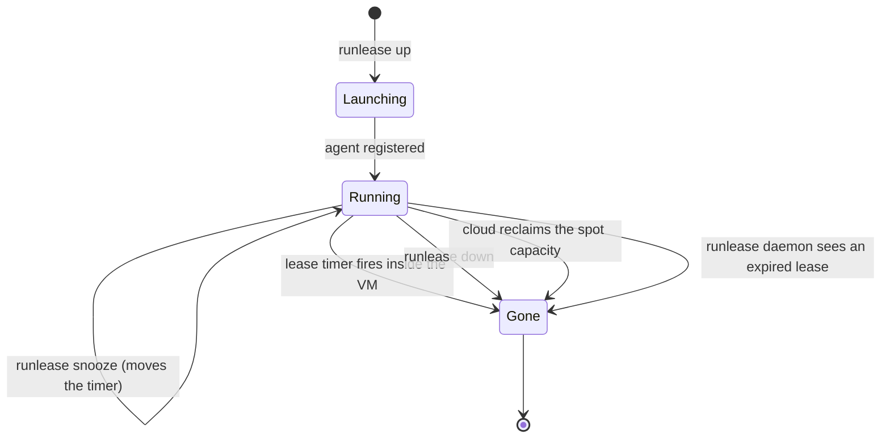

# How Runlease works

Runlease is three small programs.

| Program | Runs on | Does |
|---|---|---|
| `runlease` | Your machine, an agent's sandbox, or CI | Launches VMs through the cloud API, holds the keys, and opens every session |
| `runlease-agent` | Each VM | Dials out to the relay and hands incoming streams to `sshd` on localhost |
| `runlease-relay` | One small server with a public TLS endpoint | Matches CLI connections to the right agent and copies bytes between them |

---

## Launch: what `runlease up` does

1. **Keys.** The CLI makes two ed25519 key pairs for this VM. One logs you in. The other is the
   VM's SSH host key, chosen by you before the VM exists.
2. **Slot.** The CLI makes a random slot token and registers it with the relay, proving who you
   are with a Google ID token. The relay only ever accepts connections for tokens that were
   registered this way.
3. **VM.** The CLI asks the cloud for a spot instance and attaches a boot script. The script holds
   your public login key, the host key pair, the relay address and the slot token.
4. **Boot.** The script installs the host key, hardens `sshd`, arms the self-deletion timer,
   downloads the agent, checks it against the expected SHA-256, and starts it as an unprivileged
   service.
5. **Meet.** The agent dials out to the relay and claims the slot. The CLI polls `/ready` until
   that has happened.
6. **Connect.** The CLI opens a connection for the same slot and runs SSH across it. It accepts
   exactly one host key: the one from step 1.

## The relay protocol

Everything is a WebSocket to `/relay`. The first message is one line of JSON; after it the
connection is a plain byte stream.

| Role | Sent by | First message | Reply | Then |
|---|---|---|---|---|
| `register` | CLI at `up` | `{"role":"register","token":"…"}` plus `Authorization: Bearer <ID token>` | `{"status":"ok"}` | Closed |
| `instance` | Agent at boot | `{"role":"instance","token":"…"}` | `{"status":"registered"}` | The agent runs a [yamux](https://github.com/hashicorp/yamux) server on this socket |
| `client` | CLI, every command | `{"role":"client","token":"…"}` | `{"status":"connected"}` | Raw bytes, bridged to a new yamux stream on the agent's socket |

Two HTTP endpoints sit beside it: `GET /agent` serves the agent binary, and `GET /ready` (token in
the `X-Relay-Token` header) reports whether a slot's agent is connected.

One agent socket carries any number of sessions. That is why you can hold a port forward open in
one terminal and run `exec`, `push` and `pull` from others at the same time.

A slot lives for 24 hours. If the agent's connection drops it reconnects and reclaims the same
slot; only one agent can hold a slot at a time.

## What the relay sees

The relay sees the token, the source addresses, and an opaque byte stream that happens to be SSH.
It has no key that would let it decrypt that stream, pose as the VM, or log in. The
[threat model](security.md) goes through each case.

## Inside the VM

The boot script (`pkg/userdata/userdata.go`) does this, in order:

1. Installs `runlease-terminate` and `runlease-snooze`, the only two commands the login user may
   run as root.
2. Arms a systemd timer that runs `runlease-terminate` at the end of the lease.
3. Creates the `runlease-agent` user and installs your public login key.
4. Installs the pre-issued host key and removes every other host key.
5. Hardens `sshd`: public-key only, one allowed user, no root login.
6. Grants general `sudo` only if the manifest says `sudo: passwordless`.
7. Downloads the agent, verifies its SHA-256, and starts it under a restricted systemd unit.
8. Runs your `setup` steps as root, logging to `/var/log/runlease-setup.log`.

The lease timer is armed in step 2, before anything that can fail. A VM whose bootstrap breaks
still deletes itself.

## Leases

- `reclaim.ttl` sets the lease. `reclaim.selfTermination: true` arms the timer inside the VM.
- `runlease snooze <name> 1h` re-arms the timer over the same secure channel.
- On GCP the VM deletes itself through the Compute API. On AWS it powers off, and the instance is
  configured to terminate on shutdown.
- Every VM is tagged `runlease-managed`, `runlease-created-by` and `runlease-expires-at`.

## On your machine

Runlease keeps its state under `~/.runlease` (override with `RUNLEASE_HOME`):

| File | Holds |
|---|---|
| `config.yaml` | Your defaults |
| `registry.json` | One entry per launched VM: cloud, instance ID, relay address, slot token, forwards |
| `credentials/<id>.json` | That VM's key pairs, encrypted with AES-256-GCM |
| `master.key` | The key that encrypts them, mode 0600 |

## Without a relay

Leave `relay.addr` empty and the VM gets a public IP; the CLI connects to it directly, still with
the pre-issued host key. `runlease iap` (GCP) and `runlease ssm` (AWS) use the cloud's own tunnel
instead.

## Code map

| Path | What is there |
|---|---|
| `cmd/runlease/` | The CLI, one file per command |
| `cmd/runlease-agent/`, `pkg/agent/` | The agent |
| `cmd/runlease-relay/`, `pkg/relay/` | The relay |
| `pkg/userdata/` | The boot script template |
| `pkg/credential/` | Key generation and storage |
| `pkg/provider/` | The cloud interface and its GCP and AWS implementations |
| `pkg/manifest/` | The manifest schema |
| `pkg/lifecycle/` | The lease watcher behind `runlease daemon` |
| `pkg/pricing/` | Spot price lookup |
