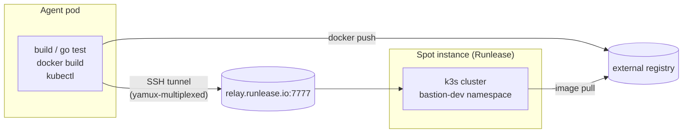

# k3s / Bastion Integration Plan

## Context

Runlease provisions ephemeral spot instances with a secure relay tunnel. This document describes how to use a spot VM as a fully-capable k8s build-and-deploy target — specifically for the Bastion platform during development — and which (small) convenience layer is still worth adding on top of the now-generic Runlease primitives.

The agent (running in a constrained pod) stays in the pod. The spot instance runs k3s. The agent builds, pushes images, deploys via kubectl over a relay-tunneled API channel, and observes results. When the session ends the cluster is gone.

---

## Architecture



Key properties:
- The spot cluster has no public IP and no inbound firewall rules.
- The only access path is the relay token issued at launch.
- The agent has no cloud credentials beyond its pod service account.
- The cluster dies with the instance TTL — no cleanup required.
- Since 0.0.6 the relay is yamux-multiplexed, so the agent can hold a `kubectl` port-forward open while running `runlease exec` / `push` / `pull` from other shells without contention.

---

## What's already shipped (use these today)

Most of the k3s bring-up plan is now solvable with generic Runlease primitives — no k3s-specific code required.

### Install k3s on boot — `manifest.setup`

`setup:` entries run as root after the runlease bootstrap completes. Output streams to `/var/log/runlease-setup.log`; `runlease up --attach` tails it to completion.

```yaml
sudo: passwordless
setup:
  - name: install-k3s
    run: |
      curl -sfL https://get.k3s.io | INSTALL_K3S_EXEC="--write-kubeconfig-mode=644" sh -
      for i in $(seq 1 60); do
        k3s kubectl get nodes 2>/dev/null | grep -q ' Ready' && break
        sleep 1
      done
```

### Port-forward 6443 — `manifest.forwards` + `runlease forward --all` (or `--attach`)

The forward uses `golang.org/x/crypto/ssh` `Dial`/`Listen` over the relay tunnel (which is itself yamux-multiplexed against the agent socket). Re-establishing without a shell is `runlease forward <name> --all`.

```yaml
forwards:
  - name: kube-api
    local: 16443
    remote: 6443
```

```
runlease up --attach -m bastion-dev.yaml
# ✅ setup completed.
# 🔀 -L 127.0.0.1:16443 → localhost:6443 (via SSH)
# Forwards active — press Ctrl+C to stop.
```

### File transfer + remote exec

- `runlease push <name> <local> <remote>` / `runlease pull` — SFTP over the SSH tunnel for build artefacts.
- `runlease exec <name> -- <cmd>` — non-interactive remote command, propagates exit code; works concurrently with `forward` thanks to yamux.

---

## What's still missing (the k3s convenience layer)

The setup-based recipe above leaves three pieces that are awkward to do by hand:

1. **Fetch the kubeconfig and rewrite the API server URL** to `https://localhost:<localPort>` so a local `kubectl` Just Works.
2. **Issue a namespace-scoped ServiceAccount token** instead of using the cluster-admin cert, so the agent can't escalate.
3. **A convenience command** to print the kubeconfig path for scripts / IDE integrations.

These are the only k3s-specific bits worth adding on top of what 0.0.6 ships.

### 1. Manifest — new `k3s` block (convenience)

```yaml
k3s:
  enabled: true
  version: "v1.32.0+k3s1"   # optional; defaults to latest stable
  namespace: bastion-dev    # created post-boot
  serviceAccount: agent     # namespace-scoped SA; kubeconfig uses its token
```

`pkg/manifest/manifest.go`:

```go
type K3sConfig struct {
    Enabled        bool   `yaml:"enabled"`
    Version        string `yaml:"version"`
    Namespace      string `yaml:"namespace"`
    ServiceAccount string `yaml:"serviceAccount"`
}
```

When the manifest loader sees `k3s.enabled: true`, it synthesises the equivalent `setup:` entries (install k3s, wait for Ready, create namespace + SA + RoleBinding) and a default `forwards:` entry mapping a free local port to `6443`. This keeps the user's manifest minimal and the underlying mechanism unchanged.

### 2. Post-`up` kubeconfig fetch

After provisioning, if `k3s.enabled`:

1. Wait for `/run/runlease-setup-done` (existing sentinel).
2. `runlease exec` to fetch:
   - `cat /etc/rancher/k3s/k3s.yaml` for the base config, OR
   - `k3s kubectl create token <sa> -n <namespace> --duration=<ttl>` if `serviceAccount` is set.
3. Rewrite `server: https://127.0.0.1:6443` → `server: https://localhost:<localPort>`.
4. Write to `~/.runlease/kubeconfigs/<name>.yaml` (mode 0600).
5. Store path on the registry entry.

`pkg/registry/registry.go` adds:

```go
type Entry struct {
    // …existing fields…
    KubeconfigPath string `json:"kubeconfigPath,omitempty"`
}
```

### 3. `runlease kubeconfig <name>`

```
runlease kubeconfig my-runner
# /Users/you/.runlease/kubeconfigs/my-runner.yaml
```

Trivial command; reads `Entry.KubeconfigPath` from the registry.

---

## Security Properties

| Concern | How it's handled |
|---|---|
| Cluster access requires relay token | k3s API is never reachable without the SSH tunnel; spot instance has no public IP |
| Agent can't reach other sessions | Each relay token is unique per instance; no cross-session routing (yamux streams are scoped to one slot) |
| Agent can't escalate k8s privileges | Kubeconfig uses an SA token scoped to one namespace; cluster-admin cert stays on the VM |
| Credentials expire with the session | SA token TTL matches instance TTL; kubeconfig is useless after the relay token is gone |
| Compromised spot instance | Agent's pod has no cloud credentials; relay token only routes to that instance; k3s API still requires the SA token |

---

## Example Manifest (after the convenience layer ships)

```yaml
name: bastion-dev
provider: aws
region: us-east-1
instanceClass: compute.large
baseImage: ami-0abcdef1234567890   # Ubuntu 24.04 LTS
reclaim:
  ttl: 4h
relay:
  addr: relay.example.com:7777
k3s:
  enabled: true
  namespace: bastion-dev
  serviceAccount: agent
tags:
  purpose: dev-cluster
  owner: agent
```

### Equivalent today (without the convenience layer)

```yaml
name: bastion-dev
provider: aws
region: us-east-1
instanceClass: compute.large
reclaim: { ttl: 4h, selfTermination: true }
relay: { addr: relay.example.com:7777 }
sudo: passwordless
setup:
  - name: install-k3s
    run: |
      curl -sfL https://get.k3s.io | INSTALL_K3S_EXEC="--write-kubeconfig-mode=644" sh -
      until k3s kubectl get nodes 2>/dev/null | grep -q ' Ready'; do sleep 1; done
      k3s kubectl create namespace bastion-dev
      k3s kubectl create serviceaccount agent -n bastion-dev
      # apply Role + RoleBinding here
forwards:
  - { name: kube-api, local: 16443, remote: 6443 }
```

Then `runlease up --attach`, and fetch the kubeconfig manually with `runlease exec` + `runlease pull`.

---

## Implementation Order (remaining work)

1. `K3sConfig` in manifest + validation
2. Synthesise `setup:` and `forwards:` from `k3s.enabled` at manifest-load time
3. `KubeconfigPath` field on the registry entry
4. Post-`up` kubeconfig fetch + rewrite in `cmd/runlease/up.go` (gated on `k3s.enabled`)
5. `runlease kubeconfig <name>` command
6. End-to-end test on a real AWS instance
