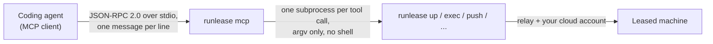

# MCP server

`runlease mcp` is a [Model Context Protocol](https://modelcontextprotocol.io) server. A coding
agent that speaks MCP gets typed tools for leased machines (launch, run a command, copy a file,
extend the lease, delete) instead of composing `runlease` shell commands and parsing their output.

It is the same binary as the CLI and adds nothing to install. The server uses the sign-in, config
and cloud credentials the CLI already uses, so get those working in a terminal first:

```bash
runlease login                       # the relay
gcloud auth application-default login   # or the usual AWS credential chain
runlease up -p gcp -n box -d && runlease down box --yes   # one launch by hand proves the setup
```

## Register it

The MCP client starts the server itself. You never run `runlease mcp` by hand.

**Claude Code**

```bash
claude mcp add runlease -- runlease mcp
```

Add `--scope user` to have it in every project. To pass a cloud project or a non-default
config directory, set them on the entry:

```bash
claude mcp add runlease -e GOOGLE_CLOUD_PROJECT=my-project -- runlease mcp
```

**Any other MCP client**

Clients that read an `mcpServers` map (Claude Desktop, Cursor, VS Code and others) take:

```json
{
  "mcpServers": {
    "runlease": {
      "command": "runlease",
      "args": ["mcp"]
    }
  }
}
```

Use the full path to the binary if `runlease` is not on the `PATH` the client starts servers with.

## MCP Registry

The server is published to the [MCP Registry](https://registry.modelcontextprotocol.io) as
`io.github.marshal-org/runlease` from each release, starting with the first release after v0.9.0.
Clients and catalogs that read the registry can find it there.

The registry entry points at MCP bundles (`.mcpb` files) attached to the GitHub release, one per
platform: `runlease-<os>-<arch>.mcpb` for linux and darwin on amd64 and arm64, and for windows on
amd64. A bundle holds the same `runlease` binary as the release and a manifest that starts it as
`runlease mcp`. The registry has no field for operating system or CPU architecture, so a client
picks its bundle by file name. Each bundle is listed in `checksums.txt` and has a build provenance
attestation, like the binaries: see [Verifying a release](security.md#verifying-a-release).

A bundle does not replace the setup above. The server still needs the sign-in and cloud
credentials, and `runlease login` is a terminal command, so install the CLI as well.

The manifest and the registry entry are built from [`mcpb/`](../mcpb) by
`scripts/build-mcpb.sh` and `scripts/gen-server-json.sh`.

## Tools

| Tool | What it does |
|---|---|
| `runlease_status` | Who is signed in, how many of the tier's machine slots are in use, and the machines this computer tracks. Read-only. |
| `runlease_up` | Launch a spot machine: `provider` (`gcp` or `aws`), optional `name`, `size`, `ttl` (default 2h), `region`, `public_ip`, `manifest`. Returns at once with the machine's details; it does not wait for boot. |
| `runlease_exec` | Run `bash -lc <command>` on a machine. Returns the exit code, stdout and stderr. `timeout_seconds` defaults to 600, at most 3600. |
| `runlease_push` | Copy one local file to a machine. |
| `runlease_pull` | Copy one file from a machine to this computer. |
| `runlease_list` | The machines this computer tracks, as JSON. Read-only. |
| `runlease_snooze` | Set a machine's self-deletion to `duration` from now. |
| `runlease_down` | Delete a machine now. Marked destructive. |
| `runlease_doctor` | Run `runlease doctor` and report what to fix. Read-only. Says so when the installed build has no `doctor` command. |

A failed command is a tool result with `isError: true` carrying the CLI's own error text, which
already says what to do next. It is not a protocol error, so the model sees it and can act on it.

Output from `runlease_exec` is cut to its last 100 KB of stdout and 16 KB of stderr, and the
result says how much was dropped. Relative `local_path` values are relative to the directory the
client started the server in.

## Safety

- **Machines cost money, in your account.** Every machine `runlease_up` launches is billed to your
  own cloud account until its lease ends and it deletes itself. The tool description tells the
  model to pick the shortest lease that fits and to delete the machine when done. `runlease_snooze`
  extends that bill.
- **`runlease_down` deletes.** The machine, its disk and everything on it are gone. There is no
  undo. It only acts on a machine this computer tracks.
- **`runlease_exec` runs anything** the model writes, on the leased machine. The machine is
  disposable and has no access to your computer, but it does have whatever you put on it and
  whatever cloud identity its manifest attaches.
- **`runlease_push` and `runlease_pull` read and write local files** with your permissions, at the
  paths the model gives. `pull` replaces an existing local file.
- **A public IP is your call.** When a subnet has no NAT gateway, `runlease_up` refuses and creates
  nothing. The model is told to ask you before retrying with `public_ip: true`, and never to set
  it on its own. The address carries outbound traffic only: SSH still listens on localhost.
- **Keep the approval prompt on.** MCP clients ask before running a tool. Leave that on for
  `runlease_up`, `runlease_exec`, `runlease_push`, `runlease_pull`, `runlease_snooze` and
  `runlease_down`; `runlease_status`, `runlease_list` and `runlease_doctor` only read.

Arguments from the model never pass through a shell on your computer. Each tool runs the
`runlease` binary directly with one argument per value, machine names are limited to letters,
digits, `.`, `_` and `-`, and a name or path that starts with `-` is refused, so a value cannot
become a flag. The security properties of the machine itself are unchanged: see
[Security and threat model](security.md).

## How it works



- **Protocol.** Hand-written against the specification, with no SDK dependency. It serves the
  current revision, `2026-07-28` (no handshake: every request carries its version, and
  `server/discover` advertises what the server supports), and also answers the `initialize`
  handshake of `2025-11-25`, `2025-06-18`, `2025-03-26` and `2024-11-05` for clients that have
  not moved yet. Only tools are offered: no resources, prompts or subscriptions.
- **Logs** go to stderr, one line per tool run with the subcommand, exit code and duration. Tool
  arguments are not logged.
- **Cancellation and timeouts.** `notifications/cancelled` kills the running subprocess. Every
  tool has a time limit (`runlease_exec`: `timeout_seconds`; launch: 10 minutes; file copy: 30
  minutes; the rest: 2 to 5 minutes). A command that `runlease_exec` gave up on may still be
  running on the machine.
- **Shutdown.** The server exits when the client closes its stdin, after calls already running
  have finished; a signal stops them at once.
- **`RUNLEASE_MCP_BIN`** makes the tools run a different `runlease` binary than the server's own.
  It exists for tests.
