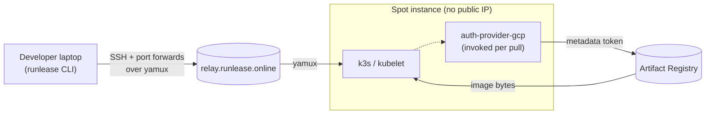

# Pulling private Google Artifact Registry images on a Runlease spot VM

Wire up an ephemeral GCP spot instance to pull from a private Artifact Registry without storing static tokens, without setting up a refresh timer, and without restarting k3s mid-session. Uses kubelet's `CredentialProvider` plugin (the same mechanism GKE uses internally) — credentials are minted just-in-time from the GCE metadata server on every pull.

Starter manifest: [`examples/manifests/gcp-ar-private-pull.yaml`](../examples/manifests/gcp-ar-private-pull.yaml).



The boxes inside the VM are the part this doc is about. Everything else is the standard Runlease relay model — see [`CLAUDE.md`](../CLAUDE.md) for the broader picture.

---

## Prerequisites

| Tool | Why |
|---|---|
| `runlease` CLI built from this repo | Spin up + connect |
| `gcloud` authenticated as a user with `serviceAccountUser` on the target project | Create the SA + grant it AR read + let you attach it |
| `kubectl` locally | Only needed once you want to deploy into the cluster |

The deployed relay binary must match your CLI version (yamux protocol) — see [`CLAUDE.md` § Deployment story](../CLAUDE.md#deployment-story).

---

## One-time IAM setup

Create a service account that the spot instance will impersonate. Grant it `roles/artifactregistry.reader` on the AR repo(s), then grant your user permission to attach it to instances.

```bash
PROJ=your-project-id
SA_NAME=ar-puller
SA=${SA_NAME}@${PROJ}.iam.gserviceaccount.com

# 1. Create the SA (skip if it already exists)
gcloud iam service-accounts create $SA_NAME \
  --project=$PROJ \
  --display-name="Runlease spot VM — Artifact Registry puller"

# 2. AR read access. Project-wide is simplest; bind on a specific
#    repo (projects/$PROJ/locations/LOC/repositories/REPO) for tighter scope.
gcloud projects add-iam-policy-binding $PROJ \
  --member="serviceAccount:$SA" \
  --role="roles/artifactregistry.reader"

# 3. Let your user attach this SA to launched instances
gcloud iam service-accounts add-iam-policy-binding $SA \
  --member="user:$(gcloud config get-value account)" \
  --role="roles/iam.serviceAccountUser"

# Verify
gcloud projects get-iam-policy $PROJ \
  --flatten='bindings[].members' \
  --filter="bindings.members:$SA" \
  --format='value(bindings.role)'
# → roles/artifactregistry.reader
```

If your project enforces an org policy that strips the `cloud-platform` access scope from instance SAs, the metadata-server token won't be able to call AR. Audit `constraints/iam.disableServiceAccountKeyCreation` and any access-scope-related constraints before debugging at the VM layer.

---

## Launch

```bash
runlease up --attach -m examples/manifests/gcp-ar-private-pull.yaml
```

Edit the manifest first to set:

- `name` — your instance name.
- `gcp.serviceAccount` — the SA email you created above.
- `forwards` — any service ports you want bound on your laptop.

What `--attach` does:

1. Provisions the spot instance.
2. Waits for the SSH tunnel via the relay.
3. Tails `/var/log/runlease-setup.log` until `__RUNLEASE_SETUP_DONE__`.
4. Activates the manifest's port forwards.
5. Blocks on Ctrl+C.

Setup runs three ordered steps inside the VM:

| Step | What it does | Why it can fail |
|---|---|---|
| `install-auth-provider-gcp` | Downloads Google's `auth-provider-gcp` binary into `/usr/local/lib/kubelet/credential-providers/` and writes a kubelet `CredentialProviderConfig` keyed to `*.pkg.dev` / `*.gcr.io`. | Pinned `APG_VERSION` is stale → 404 from GitHub releases. Bump it in the manifest. |
| `install-k3s` | `curl get.k3s.io` with `--kubelet-arg=image-credential-provider-config=…` and `--kubelet-arg=image-credential-provider-bin-dir=…`. Waits for the node to go `Ready`. | Slow network → 60s timeout. Re-launch or bump the wait loop. |
| `verify-credential-provider-wired` | `pgrep -af kubelet \| grep image-credential-provider` — fails loud if kubelet didn't pick up the flags. | Means the kubelet-arg flag names regressed in your k3s version. Setup-done marker won't fire; `--attach` reports it in the streamed log. |

If any step fails, `__RUNLEASE_SETUP_DONE__` is never written and `--attach` keeps tailing. Ctrl+C, fix the manifest, `runlease down <name>`, relaunch.

---

## Verify

While `--attach` is running (forwards held open in that terminal), from another terminal:

### 1. k8s API reachable through the forward

```bash
# Assuming `forwards: kube-api → local 16443` in the manifest
curl -sk https://localhost:16443/healthz
# → ok

curl -sk https://localhost:16443/api/v1/namespaces 2>&1 | head -5
# → K8s 401 (the apiserver is reachable; we just haven't authenticated)
```

### 2. Credential provider responds correctly

```bash
runlease exec <name> -- \
  /usr/local/lib/kubelet/credential-providers/auth-provider-gcp get-credentials --v=3 <<<'{
    "apiVersion":"credentialprovider.kubelet.k8s.io/v1",
    "kind":"CredentialProviderRequest",
    "image":"us-central1-docker.pkg.dev/your-project/your-repo/your-image:latest"
  }'
```

Expected: a JSON `CredentialProviderResponse` with an `auth` entry containing `username: oauth2accesstoken` and a non-empty `password` (the access token). If you get an error or empty auth, the SA doesn't have `roles/artifactregistry.reader` on the image's repo, or the wrong SA is attached.

### 3. Pod actually pulls

Fetch the kubeconfig (rewriting the API server URL to your local forward):

```bash
runlease exec <name> -- sudo cat /etc/rancher/k3s/k3s.yaml \
  | sed 's|https://127.0.0.1:6443|https://localhost:16443|' \
  > /tmp/runlease-test.kubeconfig

export KUBECONFIG=/tmp/runlease-test.kubeconfig
kubectl get nodes
```

Smoke-test pod referencing a private image:

```bash
kubectl run ar-smoke \
  --image=us-central1-docker.pkg.dev/your-project/your-repo/your-image:latest \
  --restart=Never \
  --command -- sleep 30

kubectl describe pod ar-smoke | grep -E 'Pulled|Failed|ImagePullBackOff'
# Look for "Successfully pulled image …" — absence of ImagePullBackOff means
# the credential provider worked end-to-end.
```

---

## How it works under the hood

When kubelet decides to pull an image, it consults `CredentialProviderConfig`. If the image matches a `matchImages` glob (`*.pkg.dev`, `*.gcr.io`, …), kubelet shells out to the configured binary with a JSON `CredentialProviderRequest` on stdin. The binary returns a `CredentialProviderResponse` on stdout containing the registry auth.

`auth-provider-gcp` reads the GCE metadata server (`/computeMetadata/v1/instance/service-accounts/default/token`) to get a fresh access token, packages it as `{ username: "oauth2accesstoken", password: <token> }`, and prints the response. Kubelet caches the response for `defaultCacheDuration` (30 min in our manifest) keyed by image, so it doesn't re-shell out on every Pod schedule.

The cache window matters: 30 min means a worst-case 30-min staleness for the token, well within the metadata token's 1-h lifetime. No expiry to manage.

---

## Why this pattern (vs the alternatives)

| Approach | Token refresh | k3s restart needed? | Setup complexity |
|---|---|---|---|
| Static token in `registries.yaml` | Expires after ~1h — pulls then fail | Yes, on every refresh | Lowest |
| systemd timer that re-mints + restarts k3s | Every ~50min | Yes (~5-15s pod disruption) | Medium |
| **kubelet `CredentialProvider`** (this doc) | **Per pull** (kubelet caches 30m) | **No** | **Medium, one-time** |
| Org policy + `generateAccessToken` 12h tokens | Once per 12h | Yes, on refresh | Requires org-admin |

CredentialProvider is the closest to "what GKE does" without buying GKE. For short-lived dev VMs the cost of setting it up (3 setup steps, ~15 lines of YAML) is a one-time write — after that, every spot instance launched from the manifest Just Works against any private repo the SA can read.

---

## Troubleshooting

| Symptom | Likely cause | Fix |
|---|---|---|
| `ERROR: kubelet did not pick up the credential provider flags` in setup log | k3s passthrough regression on `--kubelet-arg`, or wrong arg name in the manifest | Update k3s version; check that `image-credential-provider-config` is a current kubelet flag |
| `Forbidden` from `auth-provider-gcp get-credentials` | SA missing `roles/artifactregistry.reader`, or wrong SA attached to the VM | Re-run the IAM binding; confirm `gcloud compute instances describe rl-<name>-…` shows the right SA |
| `ImagePullBackOff` on a pod, `no basic auth credentials` | `matchImages` patterns don't cover your registry host | Add the exact host to `matchImages` in `/etc/kubernetes/credential-providers.yaml`. `*.pkg.dev` covers `us-central1-docker.pkg.dev` (kubelet's `matchImages` matches one DNS label per `*`) |
| `404` on `auth-provider-gcp` tarball download in setup | `APG_VERSION` pinned to a tag that was removed/renamed | Pick latest from [releases](https://github.com/kubernetes/cloud-provider-gcp/releases) and bump |
| Concurrent `runlease exec` + `forward` both time out | Deployed relay is older than yamux | Redeploy `runlease-relay` per [CLAUDE.md § Deployment story](../CLAUDE.md#deployment-story) |
| `Permission denied (publickey)` over SSH | The deployed relay/agent and your CLI are version-skewed | Rebuild the CLI; redeploy the relay if needed |
| Pod stays `Pending` with `FailedScheduling: no nodes available` | Node still booting, k3s not Ready | Wait for setup-done marker before deploying |

---

## See also

- [`examples/manifests/gcp-ar-private-pull.yaml`](../examples/manifests/gcp-ar-private-pull.yaml) — the starter manifest this doc is about
- [`docs/manifest.md`](manifest.md) — full manifest schema reference
- [`docs/k3s-bastion-integration.md`](k3s-bastion-integration.md) — proposed convenience layer (`k3s:` manifest block, kubeconfig fetch) that builds on these same primitives
- [`CLAUDE.md`](../CLAUDE.md) — architecture, security invariants, relay deployment story
