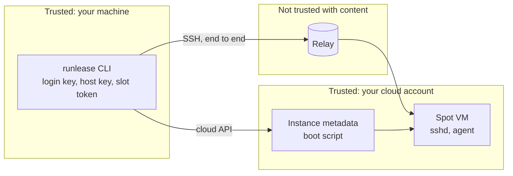

# Security and threat model

This page says what Runlease protects, from whom, and where the protection stops. It is written
to be checked: each claim names the code that backs it.

To report a vulnerability, see [SECURITY.md](../SECURITY.md).

---

## The short version

- Your SSH keys are generated on your machine and never leave it.
- The relay moves bytes. It holds no keys and no cloud credentials, and it cannot read, change or
  impersonate a session.
- The VM dials out. Runlease needs no inbound port.
- The VM's identity is fixed before it boots. Nothing is trusted on first use.
- The agent binary is verified before it runs, and then runs without privileges.
- Every VM has a lease and deletes itself when it ends.

## The parties



| Party | Trusted with |
|---|---|
| Your machine (the CLI) | Everything. It generates and stores the keys. |
| Your cloud account | Everything about the VM. Anyone who can read instance metadata in that account can read the boot script. |
| The relay | Availability only. It decides whether bytes flow. It is not trusted with their content. |
| The network | Nothing. |

## What each piece of secret material is

| Material | Made by | Lives | Purpose |
|---|---|---|---|
| Login key pair (ed25519) | CLI, per VM | Private half: your machine only. Public half: `authorized_keys` on the VM | Proves you to the VM |
| Host key pair (ed25519) | CLI, per VM | Both halves on your machine; both halves in the VM's boot script | Proves the VM to you |
| Slot token (256 random bits) | CLI, per VM | Your machine, the relay's memory, the VM's boot script | Matches your connections to that VM's agent at the relay |
| Identity token (Google ID token) | `runlease login`, or your cloud login | Sent to the relay at `up`. A `runlease login` session, with its refresh token, is kept in `~/.runlease/auth.json`, mode 0600 | Lets the relay decide who may open a slot, and how many |
| Master key (AES-256) | CLI, once | `~/.runlease/master.key`, mode 0600 | Encrypts stored key pairs at rest |

Code: `pkg/credential/credential.go`, `cmd/runlease/up.go`.

## Guarantees, and the code behind them

### The relay cannot read or alter a session

The relay bridges a raw byte stream between the CLI and the agent
(`pkg/relay/server.go`, `bridge`). What flows through it is the SSH protocol, negotiated end to
end between the CLI and the VM's `sshd`. SSH encrypts and authenticates every packet with keys the
relay never sees.

### The relay cannot impersonate the VM

The CLI generates the VM's host key before the VM exists and connects with
`ssh.FixedHostKey` (`cmd/runlease/exec.go`, `cmd/runlease/forward.go`). A relay that routes you to
any other machine fails the host key check and the connection is dropped. There is no
trust-on-first-use anywhere in the code base, and `InsecureIgnoreHostKey` is never used.

### The relay cannot log in to the VM

It never holds the login key. `sshd` on the VM accepts public-key authentication only, for one
user (`pkg/userdata/userdata.go`, the sshd hardening block).

### The agent binary is verified before it runs

The VM downloads `runlease-agent` from the relay at boot. The relay is not trusted, so the boot
script checks the download against a SHA-256 before executing it, and stops if it does not match.

- Release builds of the CLI have the digest of the matching agent compiled in
  (`-X main.agentSHA256=...`, set by the release pipeline).
- A self-built relay serves a different agent. Pin it in the manifest:

  ```yaml
  relay:
    addr: wss://relay.internal.example.com
    agentSha256: 3b0c44298fc1c149afbf4c8996fb92427ae41e4649b934ca495991b7852b855e
  ```

- `agentSha256: unverified` turns the check off on purpose. A plain `go build` of the CLI has no
  digest and prints a warning at `up`.

Code: `pkg/userdata/userdata.go`, `resolveAgentSHA256` in `cmd/runlease/up.go`.

### The agent has no privileges

The agent only dials out to the relay and connects to `localhost:22`. Its systemd unit runs as an
unprivileged user with `NoNewPrivileges`, an empty capability set, a read-only view of the system
and no access to home directories or devices.

### SSH listens on localhost only

With a relay, the VM gets no public address by default and its SSH server is bound to
`127.0.0.1`. The only way in is the agent on the VM, which dials out to the relay and hands each
connection to SSH on localhost. There is no SSH port for a firewall rule to expose.

The SSH settings are written at the top of `sshd_config`, because SSH keeps the first value it
reads. The boot script then asks SSH what it will enforce (`sshd -T`) and stops, leaving the
machine unreachable, if passwords are on, root login is allowed, or it would listen beyond
localhost.

If your subnet has no NAT gateway, set `publicIp: true`. The address is then used for outbound
traffic only; SSH still listens on localhost. Known limit 1 covers what that changes.

### sudo is off by default

The login user may run two fixed scripts as root: one that deletes the VM and one that moves the
deletion timer. General `sudo` needs `sudo: passwordless` in the manifest, set before launch.

### The relay fails closed

`runlease-relay` refuses to start without authentication unless you pass `--insecure-no-auth`.
It validates every slot token before use, caps the number of live slots in total and per signed-in
identity, gives a slot back when its machine has gone, and expires a slot after at most 24 hours. Code: `cmd/runlease-relay/main.go`, `pkg/relay/server.go`.

### AWS instances require IMDSv2

Instances are launched with `HttpTokens: required`, which blocks the usual request-forgery route
to instance metadata. Code: `pkg/provider/aws/provider.go`.

## What a compromised relay can still do

Being honest about this matters more than the list above.

| It can | It cannot |
|---|---|
| Refuse or drop your connections | Read or change what flows through them |
| See connection metadata: source addresses, timing, byte counts, slot tokens | See commands, files, or forwarded traffic |
| Open a TCP connection to your VM's `sshd` and try to authenticate | Authenticate. It has no key, and password login is off |
| Serve a different agent binary | Get it executed, when the digest is pinned (every release build) |
| Hold slots open and exhaust its own memory | Reach anything in your cloud account |

## Known limits

These are real, and they are why the trust table above lists your cloud account as trusted.

1. **Without a NAT gateway, the VM needs a public address to reach the relay.** That is the
   `publicIp: true` setting. Runlease's own SSH server still listens on localhost only, but
   anything else you start on the VM that listens on all interfaces is then exposed to whatever
   your cloud firewall allows. With no relay at all, the VM always has a public address and SSH
   listens on it: one key, one user, passwords off.
2. **The boot script contains the host private key and the slot token.** Anything that can read
   instance metadata can read them: an IAM principal with instance read access in your project or
   account, and any process on the VM that can reach the metadata server. With both, an attacker
   who can also take the agent's place at the relay could present the right host key to your CLI.
   They still could not log in to the real VM. What to do: keep instance read access in that
   project narrow, and do not let untrusted workloads on the VM reach the metadata server. On AWS,
   IMDSv2 is required; on GCP the metadata server already requires a custom header.
3. **A slot token is a bearer secret.** Whoever holds it can open a TCP connection to the VM's
   `sshd` through the relay. They cannot get past SSH authentication. Tokens are 256 random bits,
   are validated by the relay, and die with the slot.
4. **Stored keys are only as safe as your user account.** Key pairs are encrypted at rest, but the
   key that encrypts them sits beside them, readable by your user. This stops casual copying of
   the credentials directory. It does not stop someone who already runs code as you.
5. **Relay sign-in is Google identity only**, for now. A relay with no allow-list admits any
   verified Google account; tiers then decide how much each one gets. The relay learns the email
   address of whoever signs in, and logs it with each slot they open.
6. **Releasing a slot needs only its token.** Anyone who holds a slot token can free that slot.
   They could already use it, so this adds no new access, but it is a way to interrupt a session
   for someone who has stolen a token.
7. **Limits are per identity, not per person.** Someone with several Google accounts gets the
   free allowance for each. The total slot cap is the backstop.
8. **The relay sees who talks to what, and when.** Run your own if that metadata matters.
9. **`ws://` and bare `host:port` relays are plaintext at the transport layer.** SSH still
   protects the session, but the slot token and the agent download cross the network in the clear.
   Use `wss://` outside a private network.
10. **A manifest is code.** `setup` steps run as root on the VM. Read a manifest before you launch
   one you did not write.
11. **Self-deletion on GCP needs the VM's service account to be able to delete the VM.** Use a
   dedicated service account with only that permission, not a broad one. A custom
   `gcp.serviceAccount` is attached with the `cloud-platform` scope, so its IAM roles are the only
   limit on what code on the VM can do. Without that permission the VM powers itself off at the
   end of the lease instead: compute billing stops, but the stopped instance and its disk stay
   until something removes them. `runlease list` looks for exactly these: it asks the cloud for
   every machine carrying the `runlease-managed` label and shows the ones this computer does not
   track, with their disk size. `runlease down --leaked` deletes the ones that are stopped and
   past their lease, and never a running machine, and `runlease sync` and the daemon delete a stopped machine they do track.
12. **Spot VMs can be reclaimed by the cloud at any time.** That is a property of spot capacity,
   not a failure.

## Leases: making sure machines go away

A VM that outlives its purpose costs money and widens your attack surface. Three mechanisms
overlap:

1. A systemd timer inside the VM deletes the instance at the end of the lease. It does not depend
   on your machine being online.
2. Every VM is tagged with `runlease-managed`, who created it, and when it expires, so anything
   that reads your cloud inventory can find and reap strays.
3. `runlease daemon` watches leases from your side and terminates what has expired.

On GCP a preempted spot VM is deleted, not stopped. On AWS the instance terminates on shutdown.

## Verifying a release

Every release publishes `checksums.txt` with the SHA-256 of each binary.

```bash
sha256sum --check --ignore-missing checksums.txt
```

`checksums.txt` is signed with [Sigstore](https://www.sigstore.dev/) keyless signing, bound to the
release workflow's identity:

```bash
cosign verify-blob checksums.txt \
  --bundle checksums.txt.sigstore.json \
  --certificate-identity-regexp '^https://github.com/marshal-org/runlease/\.github/workflows/release-please\.yml@refs/heads/main$' \
  --certificate-oidc-issuer https://token.actions.githubusercontent.com
```

Each binary also carries a build provenance attestation:

```bash
gh attestation verify runlease-linux-amd64 --repo marshal-org/runlease
```

## How the project itself is protected

- Every pull request runs tests, static analysis, a known-vulnerability scan and a secret scan.
- Pull requests from forks run on GitHub-hosted machines with a read-only token and no secrets.
- Cloud credentials exist only in one workflow that never runs on a pull request.
- Every GitHub Action is pinned to a commit.
- Dependencies are updated weekly.

Details: [docs/ci.md](ci.md).
